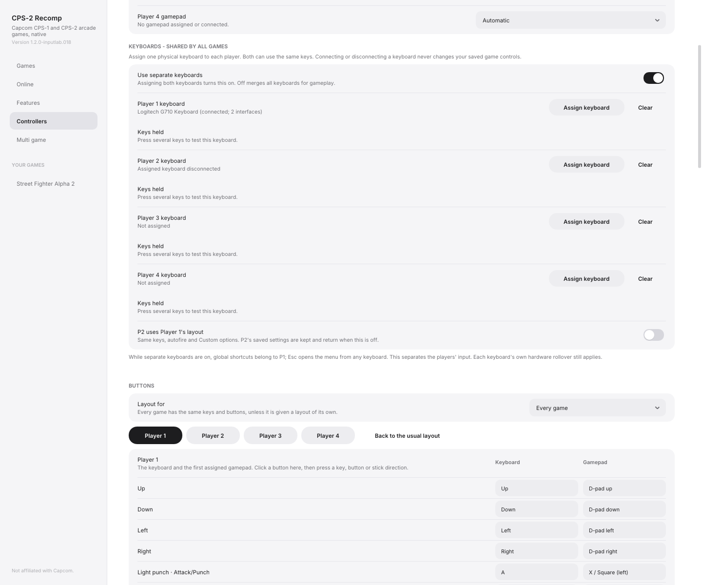
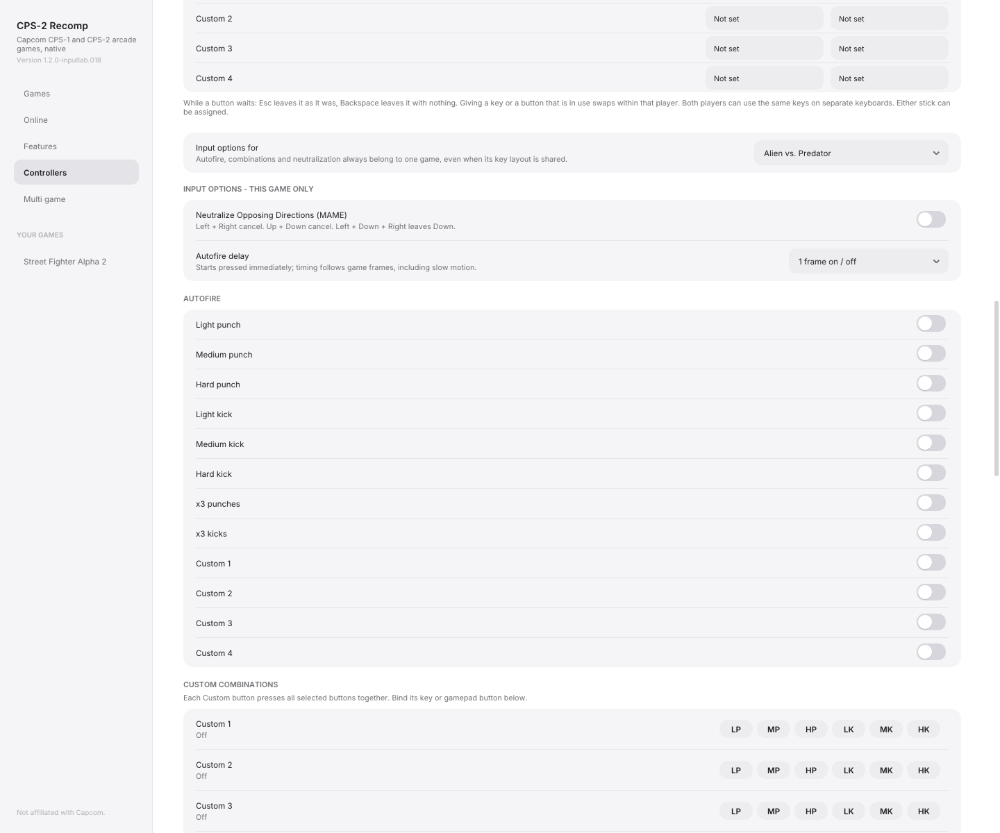
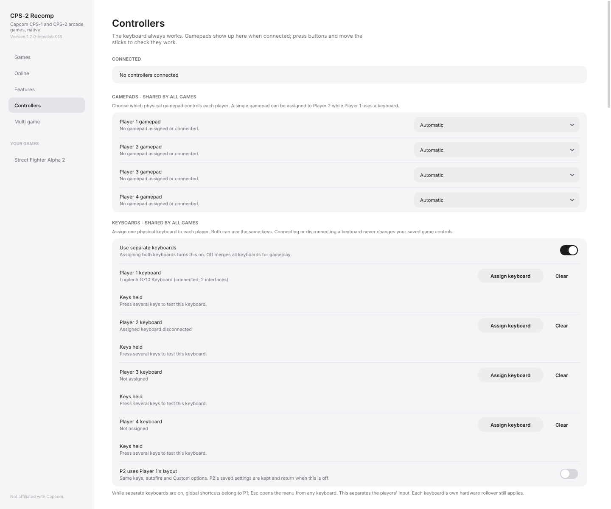
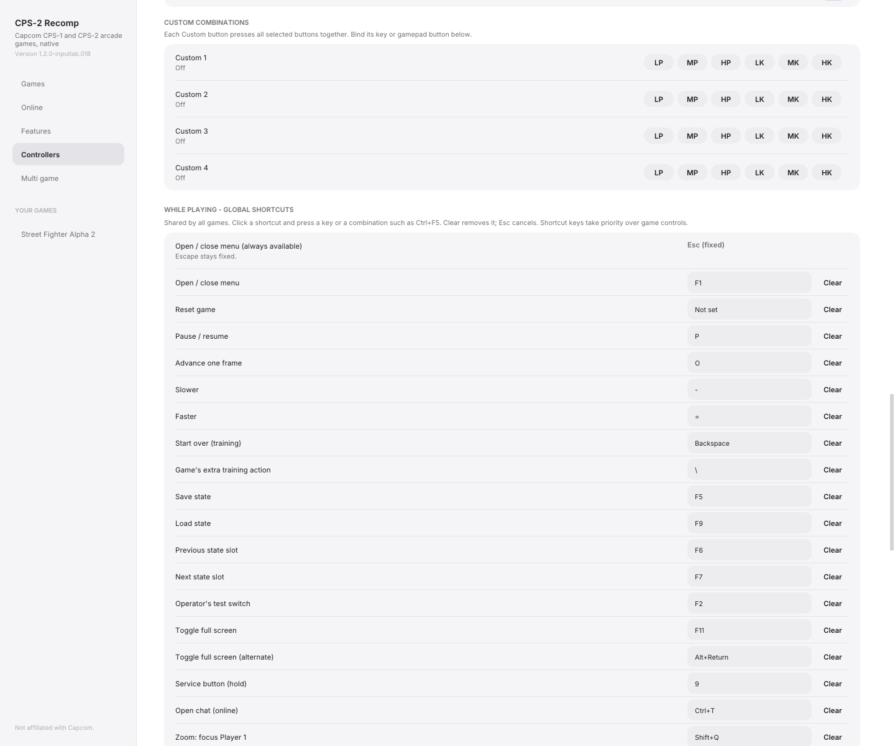
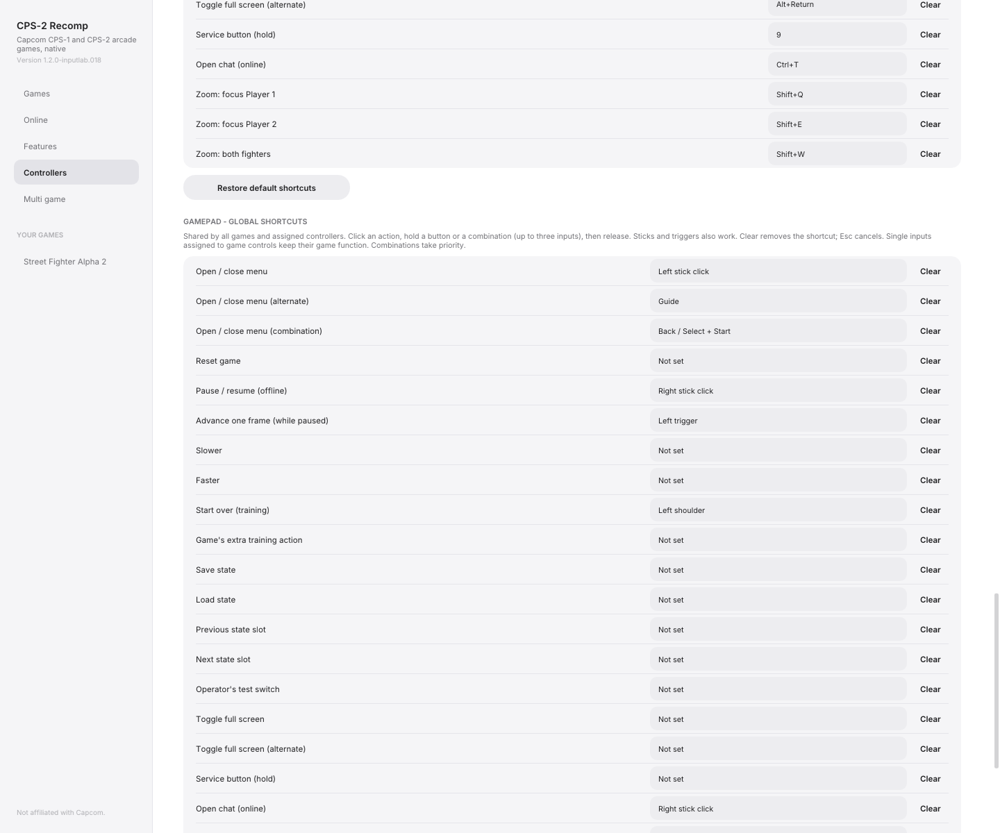
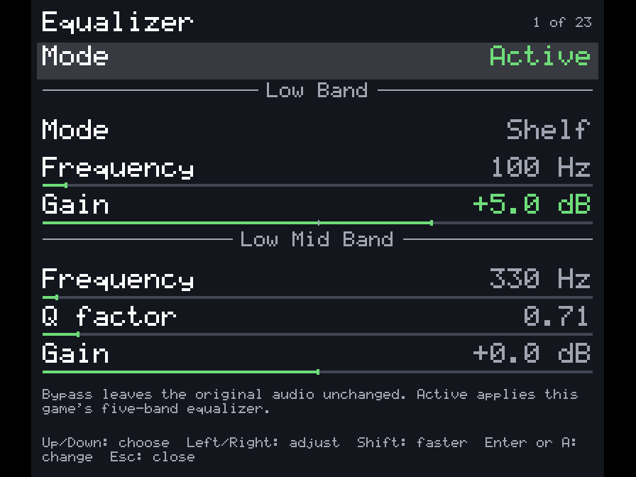
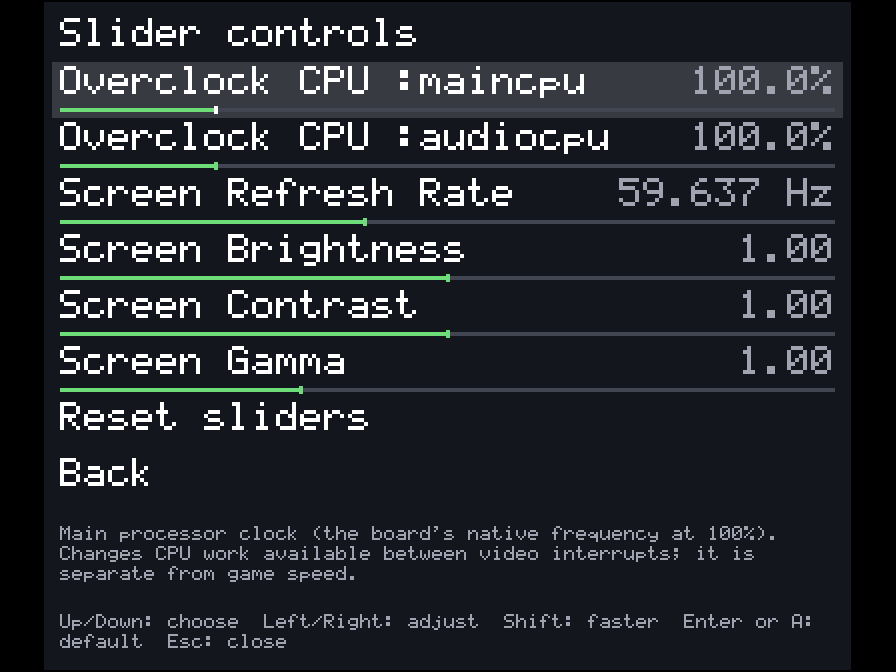
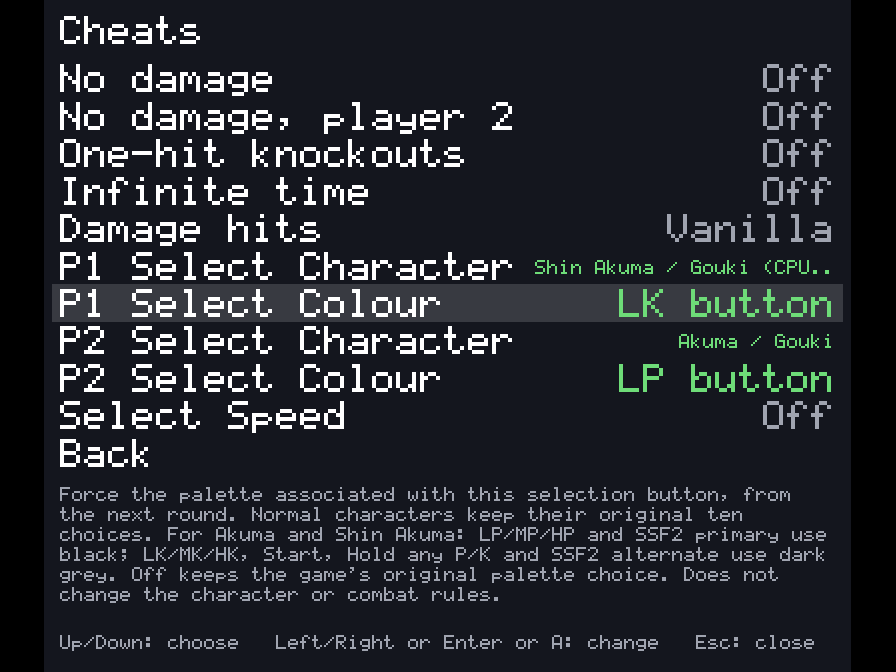
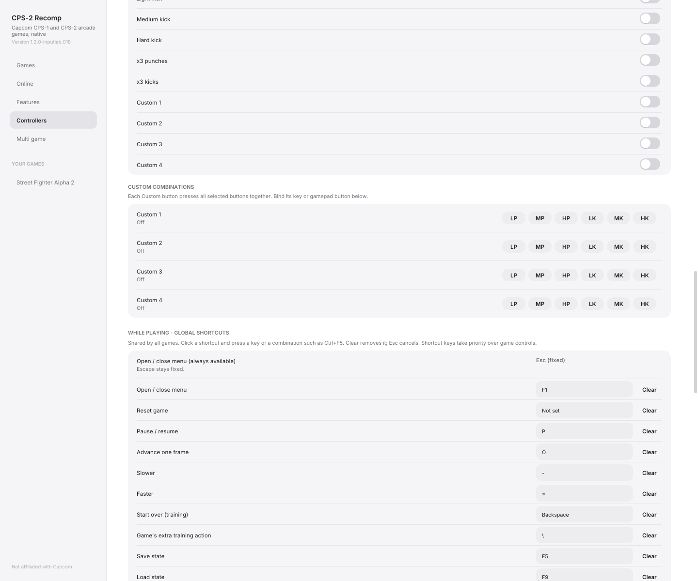

# Galería de funciones

[English](SCREENSHOTS.md) | Español

Capturas reales de Input Lab, usando ajustes aislados. No muestran identificadores de dispositivos,
rutas de ROMs ni partidas personales. Los estados de conexión corresponden al momento de la captura.
Los menús del juego se muestran sobre un fondo liso. Ilustran el fork integrado, no prueban por sí solos
la implementación o las pruebas de cada PR aislado.

## RawInput Multi Keyboard

Asignación por teclado físico y número de interfaces. El Logitech de P1 tiene dos interfaces; el teclado
guardado de P2 estaba desconectado al capturar. No es una simulación de un segundo dispositivo conectado.

## Neutralize Opposing Directions

Neutralización por juego, con explicación de ambos ejes. Los controles Custom/autofire vecinos también son por juego.

## Physics Assignment Joysticks

Cada jugador posee su selector de mando físico. No había un mando conectado al capturar; Automatic es
la política seleccionada, no una afirmación de que se haya conectado uno para esta imagen.

## Global Bindable Hotkeys

Atajos globales de teclado y accesos de mando editables/borrables. Escape sigue fijo.

## Audio Equalizer

Game → Sound → Equalizer: cinco bandas paramétricas, Active/Bypass y guardado por juego. Se ve la parte
superior del menú desplazable, con graves a +5 dB como ejemplo.

## Sliders

Seis controles por juego: CPU principal/audio, refresco virtual, brillo, contraste y gamma.

## New Cheats

Cheats propios de Super Turbo: Damage hits, personajes/jefe, paleta nativa y velocidad interna.
Consultar [la explicación completa de cada cheat](CHEATS.es.md).

## Launcher Hardening

Los botones Custom quedan dentro de su panel. Esta captura de tamaño fijo demuestra la distribución;
la ubicación automática de la ventana inicial se comprueba aparte con geometrías de escritorio y DPI.

