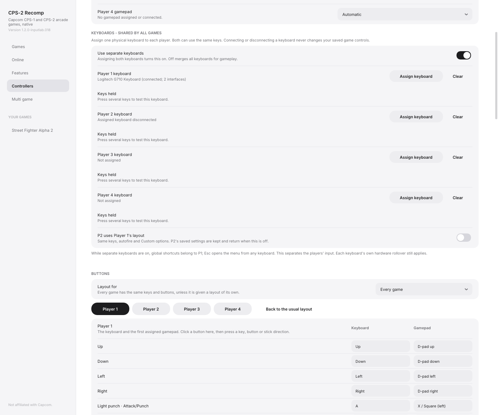
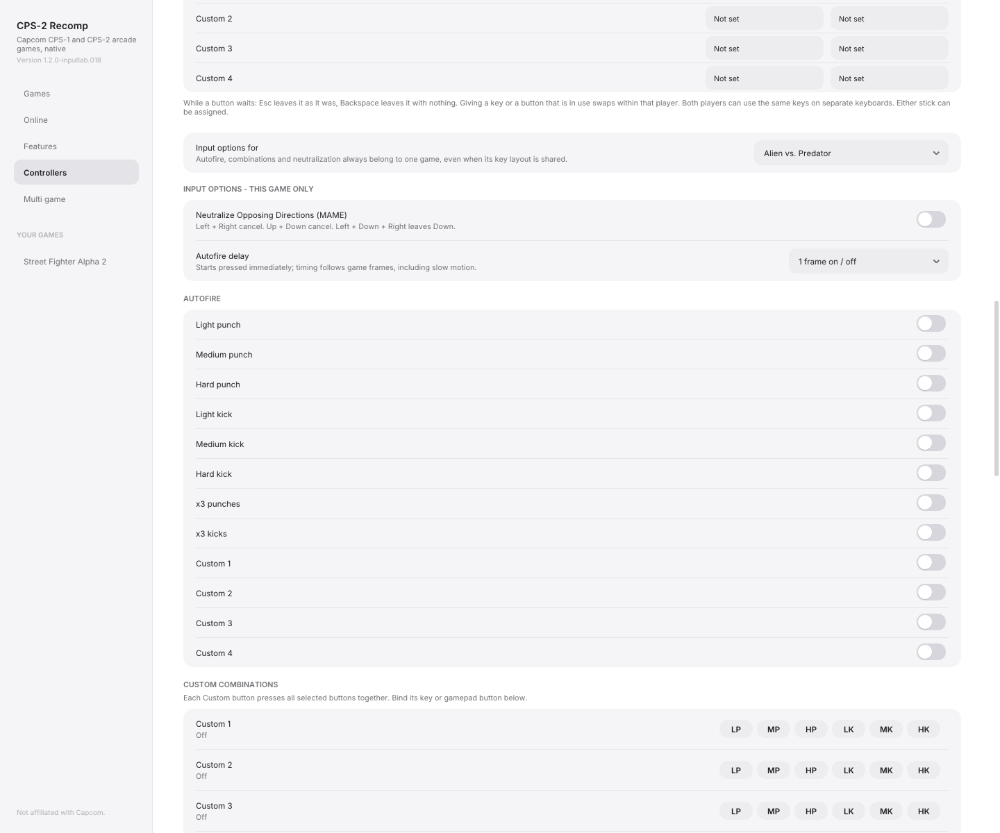
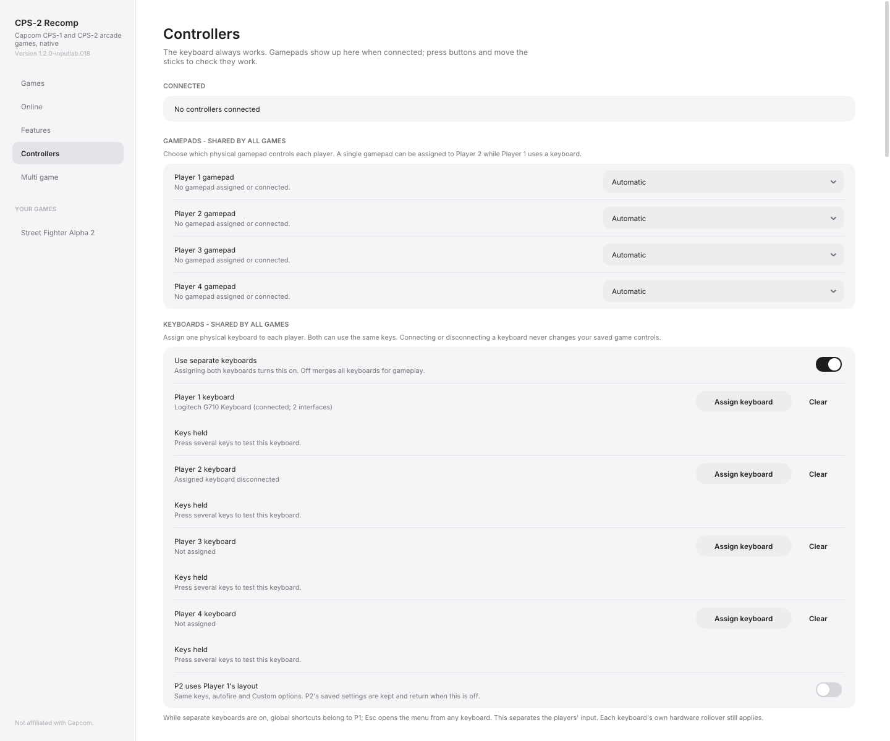
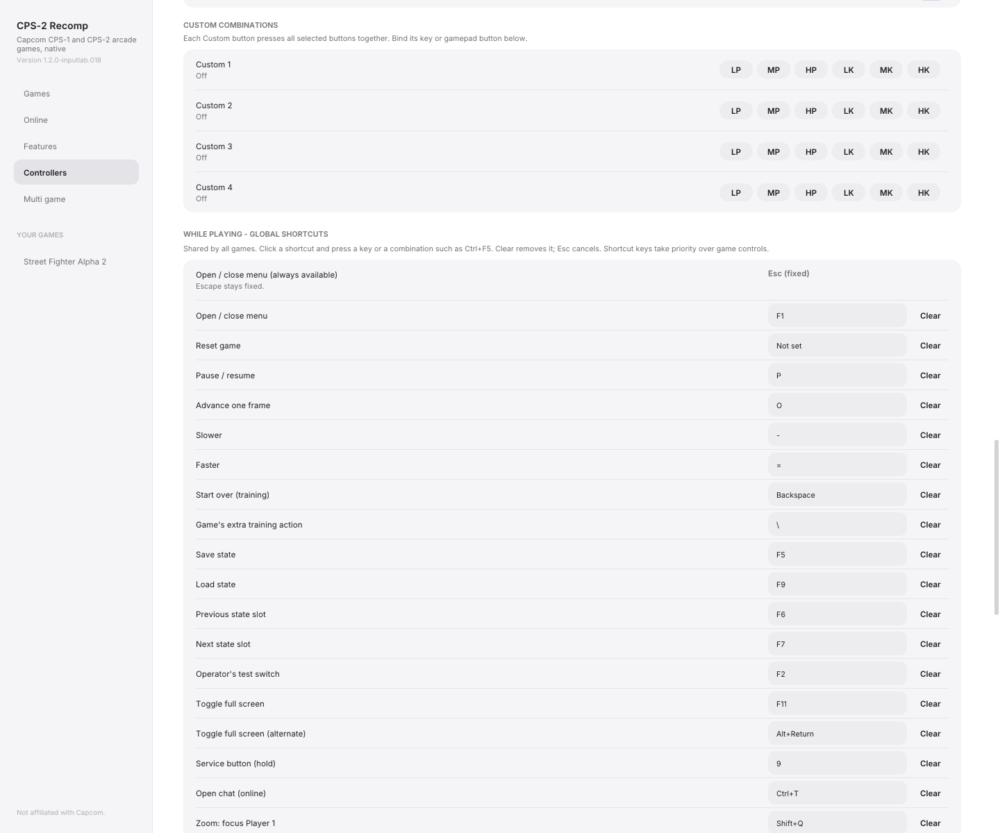
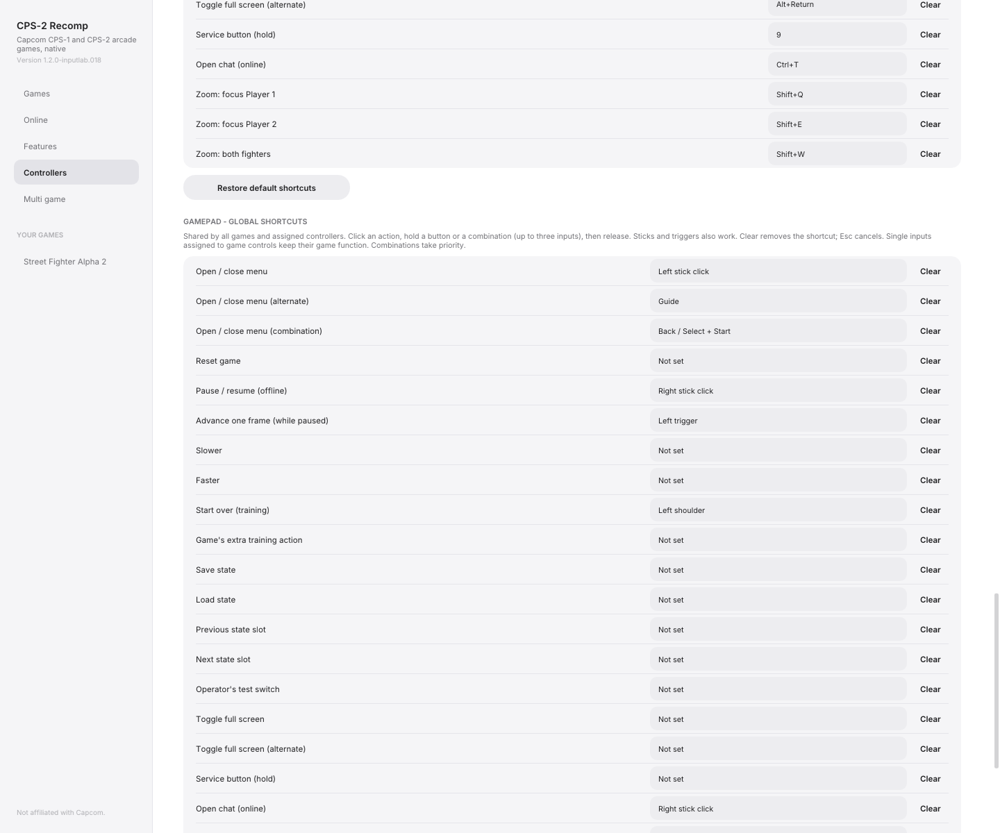
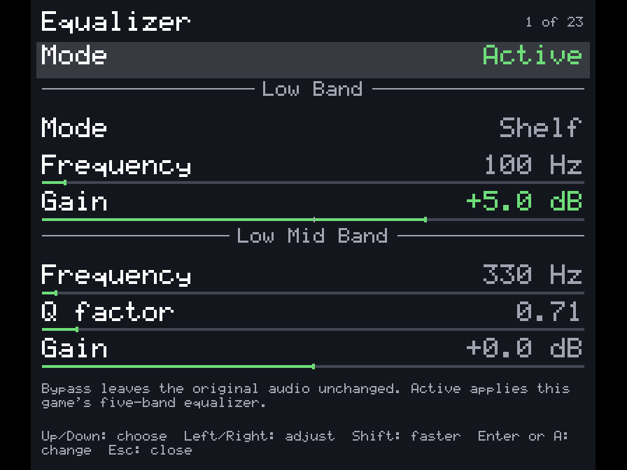
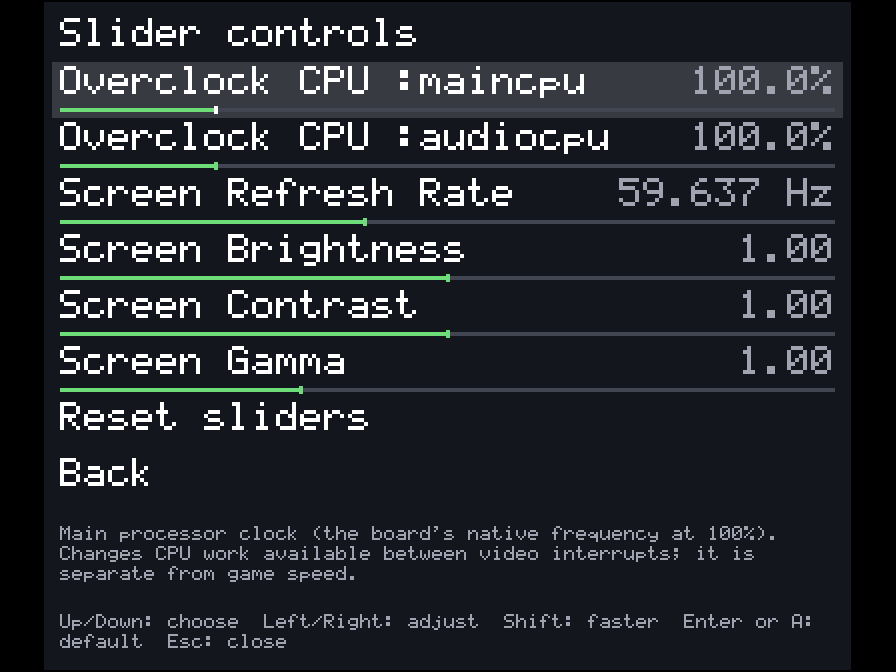
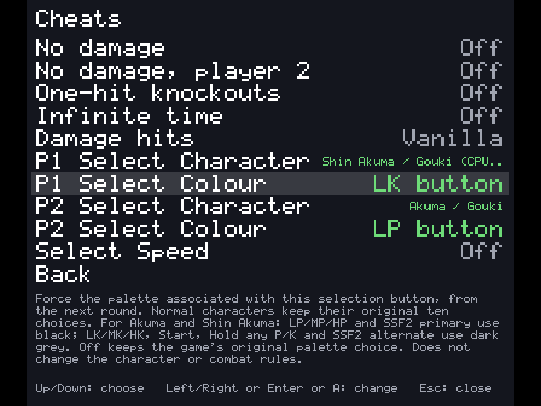
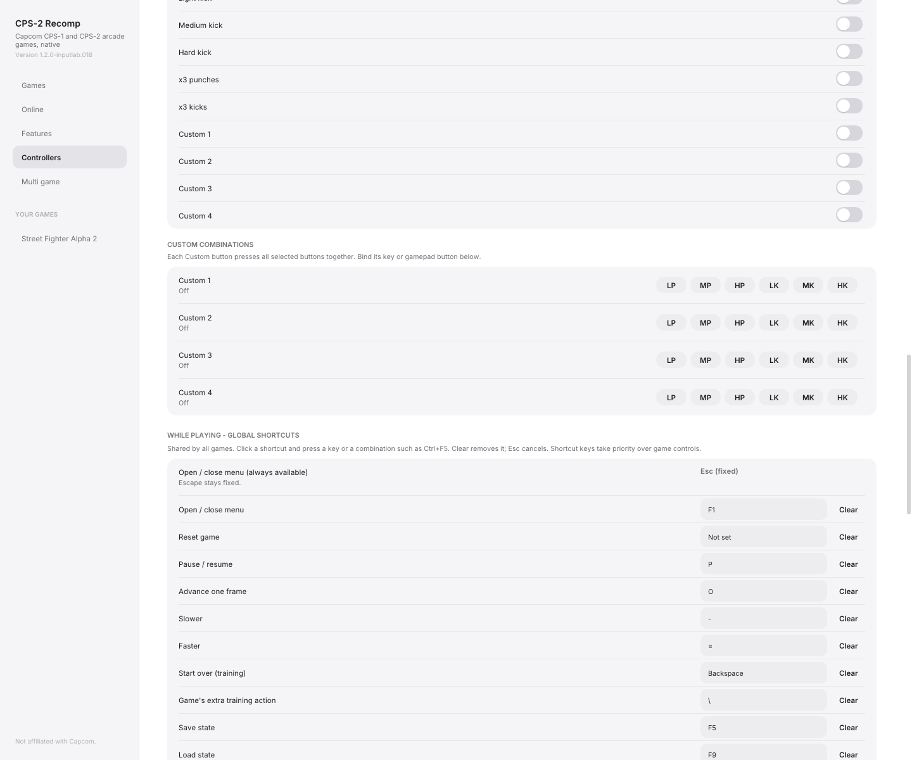

# Feature gallery

English | [Español](SCREENSHOTS.es.md)

Real Input Lab UI captures. Launcher captures use an isolated settings folder; none expose device IDs,
ROM paths or private saves. Device connection labels show the capture-time state, not a simulated second
keyboard or controller. In-game images contain the overlay itself on a plain background. These illustrate
the integrated fork; an upstream PR must state which parts its own branch implements and tests.

## RawInput Multi Keyboard

Physical keyboard assignment and interface-group count. P1's Logitech has two interfaces; the saved P2
keyboard was disconnected during this capture. The same-layout feature does not require changing P1's keys.

## Neutralize Opposing Directions

Per-game direction neutralization, with the two cancelling axis pairs explained directly in the UI.
The adjacent Custom/autofire controls are also game-specific.

## Physics Assignment Joysticks

Each player has an independent physical-gamepad selector. No pad was connected for this capture;
Automatic is a real selectable policy, not a claim of a connected test controller.

## Global Bindable Hotkeys

Global keyboard shortcuts and independently clearable gamepad menu shortcuts. Escape remains fixed.

## Audio Equalizer

Game → Sound → Equalizer. Five parametric bands, with Active/Bypass and per-game persistence.
The capture shows the top of the scrollable menu with a +5 dB bass example.

## Sliders

Six independent per-game controls: main/audio CPU, virtual video refresh, brightness, contrast and gamma.
The menu remains readable independently of the picture corrections.

## New Cheats

Super Turbo's own Cheats page includes Damage hits, character/boss selection, native colour choices
and internal speed. See [the complete explanation of every custom cheat](CHEATS.md).

## Launcher Hardening

Custom combination buttons remain within their panel, with room for labels and controls. This fixed-size
UI capture demonstrates containment; automatic initial window placement is separately tested with desktop
geometry/DPI cases, not inferred from the screenshot dimensions.

